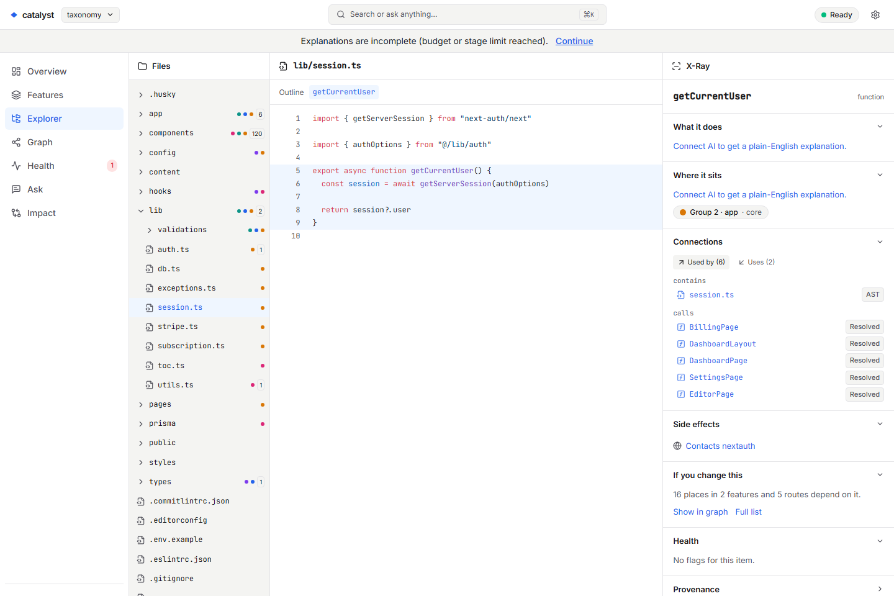

# Catalyst

Catalyst opens a local repository in a browser and lets you trace a feature back to its files, routes, database models and external services. Open a symbol in Explorer to see its callers, follow a dependency in Graph, or ask a question and open the cited code.

## Quickstart

Use Node.js 22 or newer. From the Catalyst checkout, install the workspace dependencies and build the CLI and its browser app.

```sh
corepack pnpm install --frozen-lockfile
corepack pnpm build
node packages/cli/dist/index.js ../my-project
```

The CLI prints the local URL. Open **Overview** for the detected stack, **Explorer** for source, and **Health** for structural findings. To pick a project from the launcher, run `node packages/cli/dist/index.js ui`.

For the npm distribution, the equivalent command from a project directory is `npx catalyst-dx`.

## Test locally

From the checkout in PowerShell, try the bundled TypeScript fixture with Node 22 and pnpm 9.15.9:

```powershell
pnpm install --frozen-lockfile
pnpm build
$demo = Join-Path $env:TEMP ("catalyst-demo-" + [guid]::NewGuid())
Copy-Item fixtures/repos/ts-basic $demo -Recurse
node packages/cli/dist/index.js index $demo --no-ai --json
node packages/cli/dist/index.js serve $demo
```

The index result should contain `"status":"done"` and `"llmCalls":0`. Open the printed URL, find `lib/session.ts` in **Explorer**, then open **Health** to see the cycle between `lib/a.ts` and `lib/b.ts`. Press **Ctrl+C** in the terminal to stop the server. The index and any edits to the fixture's `.gitignore` live in the temporary copy.

For Git Impact, open a Git checkout with a tracked file change. The temporary fixture above is a plain folder. The [public repository testing guide](plan/docs/test-repos.md) includes a repeatable working-tree comparison and six repositories for testing the other workflows.

To run the automated checks after installing and building:

```powershell
pnpm typecheck
pnpm test
pnpm audit --audit-level=high
pnpm --filter @catalyst/web exec playwright install chromium
pnpm --filter @catalyst/web exec playwright test
& "$env:ProgramFiles/Git/bin/bash.exe" scripts/e2e-smoke.sh
```

The last command uses Git for Windows. On Linux, use `bash scripts/e2e-smoke.sh` and install Chromium with `playwright install --with-deps chromium` through the same pnpm filter. The HTTP test prints `ALL VALID` and verifies fallback to a second port. Keep ports 4400 and 4401 available while running these checks. The automated suite uses fixtures and a local provider double, so an API key is optional for exploring Catalyst and unnecessary for these checks.

GitHub runs the checks on pushes and pull requests targeting `dev` or `main`. A successful Linux push build also uploads the installable CLI tarball under the workflow run's **Artifacts** section. [Catalyst CI runs](https://github.com/kmab5/catalyst/actions/workflows/ci.yml)

## Indexing and AI

To explore dependencies without sending code to an AI provider, run a structural index.

```sh
node packages/cli/dist/index.js index ../my-project --no-ai
node packages/cli/dist/index.js serve ../my-project
```

For summaries, feature explanations and Ask, open **Settings**, select a provider, and test the connection. Catalyst supports OpenRouter, Anthropic, OpenAI-compatible endpoints and a signed-in Claude Code CLI. You can also supply an API key through `OPENROUTER_API_KEY`, `ANTHROPIC_API_KEY` or `OPENAI_API_KEY`. Choose models available to your provider account and set a per-run budget if needed.

To try the fixture with OpenRouter's free models, use the same PowerShell session as the local walkthrough. Put `OPENROUTER_API_KEY` in the checkout's ignored `.env`. Run the following after stopping the structural server. New OpenRouter configurations default to the free router. These session overrides also select it when a different model was previously saved. Indexing sends selected fixture content to OpenRouter. [OpenRouter free models](https://openrouter.ai/openrouter/free)

```powershell
$env:CATALYST_PROVIDER = "openrouter"
$env:CATALYST_MODEL_FAST = "openrouter/free"
$env:CATALYST_MODEL_SMART = "openrouter/free"
node --env-file=.env packages/cli/dist/index.js index $demo --concurrency 1
node --env-file=.env packages/cli/dist/index.js ask "Where is the current user's session loaded?" $demo
```

```sh
node packages/cli/dist/index.js index ../my-project
node packages/cli/dist/index.js ask "Where are requests authenticated?" ../my-project
```

The index lives in the project's `.catalyst/` directory. The local server binds to `127.0.0.1` by default. AI requests send selected project context to your configured provider. [Configuration and privacy](plan/docs/12-config-and-privacy.md)

## Take a tour

The four-minute walkthrough follows a Stripe webhook and a session helper in Taxonomy, then switches to a Python backend. [Demo script](demo/script.md) · [Product and architecture](plan/docs/README.md)

The screenshots below use a real Taxonomy checkout with a partially completed AI index. The parser and dependency graph supply the routes, groups, connections and health findings shown here.



**Explorer.** The X-Ray for `getCurrentUser` links to five calling components and pages. Its plain-English summary was still pending at capture time.

| Screen | What the partial index shows |
| --- | --- |
| [Overview](demo/screenshots/overview.png) | Detected frameworks, HTTP entry points and health counts. |
| [Feature detail](demo/screenshots/feature.png) | A dependency-based group that contains the Stripe webhook, with structural changeability evidence. |
| [Graph](demo/screenshots/graph.png) | A two-hop view centered on `lib/session.ts`, with 35 nodes and 100 connections. |
| [Health](demo/screenshots/health.png) | Grouped findings for inspecting route checks and function complexity. |
